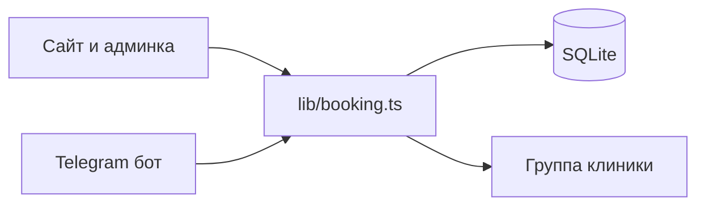

# Клиника «Верба»: запись с сайта и из Telegram

Пустой репозиторий. В записи нет барбера: клиент выбирает **день, время и медика**.

Название: **клиника «Верба»**. Вымышленный адрес: Казань, ул. Садовая, 18. Телефон клиники и шесть медиков — мокап.

## Стек

- Next.js (App Router) + TypeScript + Tailwind. Сайт и API в одном приложении.
- SQLite (`better-sqlite3`) в [`data/clinic.sqlite`](data/clinic.sqlite), режим WAL: сайт и бот открывают один файл.
- Telegram-бот на grammY, long polling (`npm run bot`). Без токена сайт работает, бот пишет, что нужен `TELEGRAM_BOT_TOKEN`.
- Общая логика записи в [`lib/booking.ts`](lib/booking.ts) — и API, и бот вызывают её, слоты не расходятся.
- После успешной заявки [`lib/notify.ts`](lib/notify.ts) шлёт копию в группу клиники через Bot API (`sendMessage`). Тот же вызов с сайта и из бота. Нужны `TELEGRAM_BOT_TOKEN` и `TELEGRAM_GROUP_CHAT_ID`. Бота добавляют в группу и разрешают писать. Без этих переменных заявка сохраняется, в лог пишется, что дубль в группу пропущен. Сиды в группу не отправляются.
- Тема: CSS-переменные, класс на `<html>`, переключатель в шапке, выбор в `localStorage`. Светлая — тёплая бумага и глубокий зелёный. Тёмная — тёмный хвойный фон, тот же акцент. Шрифты: Literata для заголовков, Manrope для интерфейса.

## Данные

Медик: имя, специальность, длительность слота, график (день недели + начало и конец, один интервал на день).

Заявка: медик, дата, время, имя, телефон, источник (`site` | `telegram`), `telegramUserId`, статус `booked` | `cancelled`.

Уникальность: один активный приём на медика, дату и время. Слот только внутри графика и не в прошлом.

Сиды при пустой базе:

- Анна Соколова, терапевт, пн–пт 09:00–17:00
- Илья Морозов, кардиолог, пн/ср/пт 10:00–16:00
- Мария Лебедева, невролог, вт/чт 09:00–15:00, сб 10:00–14:00
- Павел Орлов, ЛОР, пн–сб 08:00–14:00
- Елена Крылова, дерматолог, вт–сб 12:00–19:00
- Сергей Волков, педиатр, пн–пт 09:00–13:00

Плюс 15–25 записей на текущую и следующую неделю, чтобы в админке нагрузка отличалась (кардиолог плотнее, педиатр свободнее).

## Интерфейсы

**Лендинг** [`app/page.tsx`](app/page.tsx): шапка с переключателем темы, герой, специалисты из базы, шаги «сайт или Telegram», адрес, кнопка «Записаться».

**Запись** [`app/book/page.tsx`](app/book/page.tsx), один экран. Клиент выбирает день, время и медика:

1. Карточки медиков.
2. Месяц: рабочие дни выбранного медика доступны, прошедшие и выходные выключены, день без свободных слотов помечен как полный.
3. Сетка времени выбранного дня.
4. Имя и телефон, подтверждение. Источник заявки — `site`. Сразу после сохранения — сообщение в группу.

**Админка** [`app/admin/page.tsx`](app/admin/page.tsx): пароль из `ADMIN_PASSWORD` (в `.env.example` демо-значение `verba-admin`), httpOnly-cookie. Нагрузка по каждому медику на 7 дней: занято / всего слотов и заявки на сегодня. Форма нового медика: имя, специальность, длина слота, дни и время. Список медиков с правкой графика. Новая заявка с сайта или из бота сразу меняет занятость.

**Бот** [`bot/index.ts`](bot/index.ts): `/start` — Записаться, Мои записи, О клинике. Запись: медик → день → время → имя → телефон → подтверждение. «Мои записи» по Telegram id, отмена снимает слот. Ссылка на бота на лендинге из `TELEGRAM_BOT_USERNAME`.

**Группа.** Текст дубля: новая заявка, источник (сайт или Telegram), медик и специальность, дата и время, имя и телефон, номер заявки. Отмена тоже пишется в ту же группу, чтобы слот не считали занятым. В `.env.example`: `TELEGRAM_GROUP_CHAT_ID`. В [`Context/DEPLOY.md`](Context/DEPLOY.md) — как узнать id группы и добавить бота.

## Контекст проекта

По правилам проекта завести [`.cursor/MEMORY.md`](.cursor/MEMORY.md), [`.cursor/TASK.md`](.cursor/TASK.md), [`Context/PLAN.md`](Context/PLAN.md), [`Context/MEMORY.md`](Context/MEMORY.md), [`Context/DEPLOY.md`](Context/DEPLOY.md): стек, команды, демо-пароль, как запустить бота и как подключить группу для дублей заявок. Секреты только в `.env`, не в заметках.

README: `npm install`, `npm run dev`, `npm run bot`, переменные из [`.env.example`](.env.example).

## Проверка

В браузере: лендинг, переключение темы, запись на свободный слот (день, время, медик), отказ на занятый, админ-логин, нагрузка, добавление медика и появление его дней в календаре. Бот без токена не блокирует сайт. С токеном и id группы заявка с сайта и из бота один раз попадает в базу и дублируется сообщением в группу; тот же слот нельзя занять дважды.